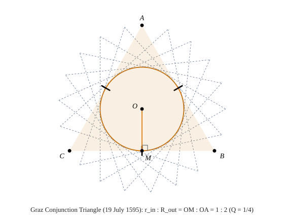

<a href="https://geometor.github.io/kepler/"></a>

# GEOMETOR • kepler

**Visit the Online Archive:** https://geometor.github.io/kepler/

<p align="center">
  <a href="https://geometor.github.io/kepler/"></a>
</p>

**Johannes Kepler • Mysterium Cosmographicum, Strena, Harmonices Mundi • semantic digital archive**

## Mission

`geometor/kepler` is part of the interconnected [GEOMETOR](https://geometor.com) semantic digital archive. It liberates Johannes Kepler's seminal treatises—*Mysterium Cosmographicum* (1596/1621), *Strena seu de Nive Sexangula* (1611), and *Harmonices Mundi* (1619)—from isolated print bounds into addressable semantic units, four synchronized reading tracks, calibrated theme-adaptive vector diagrams, primary-source folio provenance, and exact symbolic geometry demonstrations across the GEOMETOR corpus.

## Books in This Archive

- [The Harmony of the World](https://geometor.github.io/kepler/harmonices_mundi/) — *Harmonices Mundi Libri V* (1619) establishing the classification of regular and star polyhedra, uniform planar tessellations, the Kepler right triangle, and the Third Law of planetary motion.
- [The Cosmographic Mystery](https://geometor.github.io/kepler/mysterium_cosmographicum/) — *Mysterium Cosmographicum* (1596 / 1621) modeling the six Copernican planetary orbits via the nested five Platonic solids and polar-duality invariants.
- [The Six-Cornered Snowflake](https://geometor.github.io/kepler/strena_sexangula/) — *Strena seu de Nive Sexangula* (1611) founding mathematical crystallography, sphere close-packing, the Kepler conjecture, and rhombic polyhedra.

## Repository Contents

- `docsrc/` — Four-track Book Codices (616 primary folios, 34 archival bitmap plates, 14 calibrated `.euclid-graphic` SVGs), interactive **Tabula III 3D WebGL CAD Studio** & **Harmonices Mundi Live Celestial Music Studio**, stereo organ `.mp3` & microtonal `.mid` assets, and Sphinx docs compiled by [PHOTON publish](https://github.com/photon-platform/publish).
- `tabula_iii_3d/` — 13-group parametric 3D CAD reconstruction of Tabula III (1597, folio `0034`) with IngeTrazo `.igz`, glTF `.glb`, Wavefront `.obj`, and native Blender `.blend` exports.
- `resources/` — Primary 300-DPI folio scans (616 tracked folios), structure maps, persons/citations registries, and review manifests.
- `src/geometor/kepler/` — Exact symbolic models in SymPy, polyhedral & crystallographic analyzers, and the 5-limit Just-Intonation celestial music engine (`music.py`).

## Local Build & Verification

```bash
publish build
uv run --no-sync pytest
```
## Part of the GEOMETOR Knowledge Archive

Explore all **74 Book Codices** and **11 Mathematical Catalogs** at https://geometor.com/books/.
