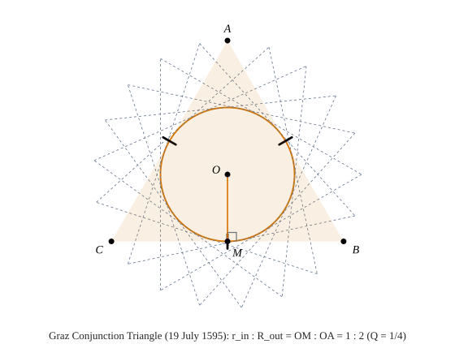

GEOMETOR • kepler
=================

**Visit the Online Archive:** https://geometor.github.io/kepler/

**Johannes Kepler • Mysterium Cosmographicum, Strena, Harmonices Mundi • semantic digital archive**

Mission
-------

``geometor/kepler`` is part of the interconnected `GEOMETOR <https://geometor.com>`_ semantic digital archive. It liberates Johannes Kepler's seminal treatises—*Mysterium Cosmographicum* (1596/1621), *Strena seu de Nive Sexangula* (1611), and *Harmonices Mundi* (1619)—from isolated print bounds into addressable semantic units, four synchronized reading tracks, calibrated theme-adaptive vector diagrams, primary-source folio provenance, and exact symbolic geometry demonstrations across the GEOMETOR corpus.

Books in This Archive
---------------------

- `The Harmony of the World <https://geometor.github.io/kepler/harmonices_mundi/>`_ — *Harmonices Mundi Libri V* (1619) establishing the classification of regular and star polyhedra, uniform planar tessellations, the Kepler right triangle, and the Third Law of planetary motion.
- `The Cosmographic Mystery <https://geometor.github.io/kepler/mysterium_cosmographicum/>`_ — *Mysterium Cosmographicum* (1596 / 1621) modeling the six Copernican planetary orbits via the nested five Platonic solids and polar-duality invariants.
- `The Six-Cornered Snowflake <https://geometor.github.io/kepler/strena_sexangula/>`_ — *Strena seu de Nive Sexangula* (1611) founding mathematical crystallography, sphere close-packing, the Kepler conjecture, and rhombic polyhedra.

Python Package & Modules
------------------------

The ``geometor-kepler`` Python package (``import geometor.kepler``) provides the executable symbolic geometry, construction, and compilation modules powering this archive:

- ``harmonices_geometry.py`` — Exact symbolic geometry of Kepler's *Harmonices Mundi* (1619) & 1597 Kepler Triangle.
- ``mysterium_spheres.py`` — Exact symbolic geometry of Kepler's *Mysterium Cosmographicum* (1596 / 1621).
- ``strena_packing.py`` — Exact symbolic geometry of Kepler's *Strena seu de Nive Sexangula* (1611).
- ``cli.py`` — Rich CLI verification report for GEOMETOR Kepler (``geometor-kepler``).
- ``sphinx_ext.py`` — Runtime Sphinx & photon-platform/publish integration for GEOMETOR Kepler.

See the `API Reference <https://geometor.github.io/kepler/modules/>`_ for full module documentation.

Repository Contents
-------------------

- ``docsrc/`` — Four-track Book Codex, apparatus registries, and Sphinx docs compiled by `PHOTON publish <https://github.com/photon-platform/publish>`_.
- ``resources/`` — Primary folio scans, structure maps, persons/citations registries, and review manifests.
- ``src/geometor/kepler/`` — Exact symbolic models in SymPy, polyhedral analyzers, and demonstration pipelines.

Local Build & Verification
--------------------------

.. code-block:: bash

   publish build
   uv run --no-sync pytest

Part of the GEOMETOR Knowledge Archive
--------------------------------------

Explore all **74 Book Codices** and **11 Mathematical Catalogs** at https://geometor.com/books/.
